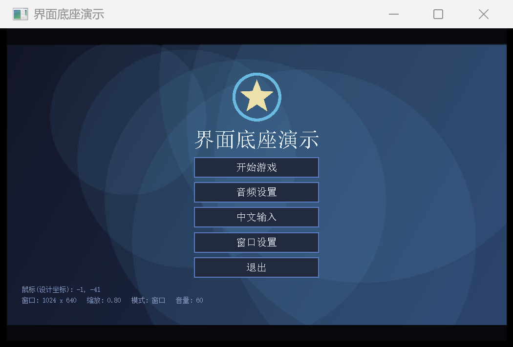
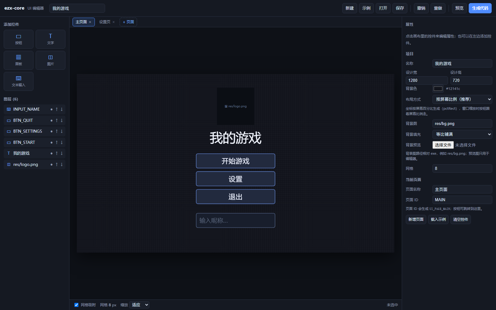

# ezx-core —— EasyX 界面底座

只提供底层能力，不提供按钮外观：窗口、适配、输入、图片、文本编辑、页面。

| 模块 | 负责 |
|---|---|
| `Window` | 建窗、全屏/工作区切换、拖拽缩放后自动重建、动态限帧 |
| `Viewport` | 1280×720 设计坐标 → 窗口坐标，等比缩放 + 黑边/裁边 |
| `Input` | 鼠标、键盘、点击/双击/拖拽/滚轮、中文输入法定位 |
| `Image` | png 加载、拉伸/等比/铺满、alpha 透明、按源矩形绘制（图集） |
| `TextInput` | UTF-8 文本编辑、中文、光标、长度/数字/密码 |
| `Page` / `Pages` | 每页独立的排版/更新/绘制 |
| `SpriteSheet` / `Animation` / `Sprite` | 图集切帧、帧动画、精灵移动（v2.1） |
| `Scene` / `Entity` / `Camera2D` | 实体容器、静态碰撞体、轴分离碰撞、相机跟随（v2.2） |



## 三步接入

1. 把 `easyx_core.h` + `easyx_core.cpp` 复制进工程，VS 里「添加 → 现有项」；
2. `#include "easyx_core.h"`；
3. 编译。

EasyX 的库已经用 `#pragma comment(lib, ...)` 写进头文件；但 **`/MT`、`/utf-8`、EasyX lib 目录** 是工程级设置，源码管不了。

**不想手动配置**：把 [Directory.Build.targets](Directory.Build.targets) 复制到项目根目录（和 `.vcxproj` 同级），MSBuild 会自动设置 `/MT`、`/utf-8`、`/U_DEBUG`、`NDEBUG` 和 EasyX 头文件/库目录。

## 最小骨架

```cpp
#include "easyx_core.h"
using namespace ezx;

int main()
{
    Window::enableDpiAwareness();

    Window   win;
    Viewport vp;
    Input    in;
    Pages    pages;

    vp.setDesign(1280, 720);
    win.onResize([&](int w, int h) {
        vp.fit(w, h);
        pages.layoutAll(vp);
    });

    if (!win.open(1024, 640)) return 1;

    Page& home = pages.add("home");
    home.draw = [](const Viewport& vp) {
        vp.textIn(Rect{ 0, 100, 1280, 80 }, "你好", 54, RGB(255, 255, 255));
    };

    vp.fit(win.width(), win.height());
    pages.go("home");

    while (true)
    {
        win.poll();
        in.update();
        pages.update(in);

        win.beginFrame(RGB(10, 10, 14));
        vp.paintLetterbox(RGB(10, 10, 14));
        pages.draw(vp);
        win.endFrame();          // 动态限帧，默认 60 FPS
    }
}
```

## 核心 API

### Window

| 调用 | 说明 |
|---|---|
| `open(w, h, mode)` | 建窗：`Windowed` / `WorkArea` / `Fullscreen` |
| `poll()` | 每帧调用；处理拖拽、最大化、重建、`onResize` |
| `onResize(fn)` | 客户区尺寸变化回调 |
| `applyMode(mode, w, h)` | 运行时切全屏/窗口 |
| `beginFrame()` / `endFrame()` | 清屏 / 翻页 + 动态限帧 |
| `setTargetFps(fps)` | 默认 60；0 = 不限帧 |
| `setTitle()` | 标题（重建后保留） |

### Viewport

| 调用 | 说明 |
|---|---|
| `setDesign(w, h)` / `fit(w, h)` | 设计分辨率 / 窗口变化时重算 |
| `R(rect)` / `R(x,y,w,h)` | 设计矩形 → 屏幕矩形 |
| `hit(rect, pos)` | 鼠标是否命中设计矩形 |
| `toDesign(pos)` | 鼠标 → 设计坐标 |
| `fill/frame/text/textIn` | 设计坐标绘制 |
| `image/imageFit/imageCover` | 拉伸 / 等比 / 铺满 |
| `setScaleMode(Contain/Cover)` | 留黑边 / 裁边铺满 |
| `paintLetterbox(color)` | 涂黑边 |

### Input

| 调用 | 说明 |
|---|---|
| `pos()` / `pressPos()` | 鼠标位置 / 按下位置 |
| `down()` / `up()` / `held()` / `clicked()` | 按下 / 松开 / 按住 / 点击 |
| `doubleClicked()` / `dragging()` / `wheel()` | 双击 / 拖拽 / 滚轮 |
| `keyDown(vk)` / `keys()` | 键盘 |
| `chars()` / `charsUtf8()` | 本帧输入字符（UTF-16 / UTF-8） |
| `mouseIn(rect)` / `clickedIn(rect)` | 屏幕矩形命中 |
| `setHandCursor(bool)` | 悬停小手 |
| `setImePosition(x, y)` | 输入法候选框位置 |

### Image / 资源路径

```cpp
Image img;
img.load(assetPath("res/logo.png"));   // exe 目录 + 相对路径
img.drawFit(Rect{ 40, 40, 200, 200 }); // 等比放入
```

`assetPath` 不依赖当前工作目录；发布时把 `res` 放在 exe 旁边。

### SpriteSheet / Animation / Sprite

```cpp
SpriteSheet sheet;
sheet.loadGrid(assetPath("res/hero.png"), 32, 32, 4);   // 32×32 一帧，4 列
// 或者一帧一个文件：sheet.loadSequence(assetPath("res/walk_"), ".png", 1, 4, 4);

Animation walk;
walk.setFrames(0, sheet.count() - 1);
walk.setFps(10);
walk.setLoop(true);

Sprite hero;
hero.setSheet(sheet);
hero.setPosition(480, 430);
hero.setScale(2);              // 放大 2 倍
hero.setAnchor(0.5f, 1.0f);    // 锚点 = 脚底中心（默认也是这个）

// 每帧
hero.update(dtMs);             // 推进动画
hero.draw(vp);                 // 用设计坐标画
Rect box = hero.bounds();      // 碰撞 / 点击判定用
```

| 调用 | 说明 |
|---|---|
| `SpriteSheet::loadGrid(path, fw, fh, cols=0, count=0)` | 一张图集按网格切帧；`cols=0` 自动按图宽算，`count=0` 全切 |
| `SpriteSheet::loadSequence(prefix, suffix, first, last, digits=4)` | 一帧一个文件，帧号补零（`walk_0001.png`） |
| `Animation::setFrames` / `setFps` / `setLoop` | 帧区间、帧率、是否循环 |
| `Animation::play/stop/reset` | 播放控制；非循环播完 `finished()` 为 true |
| `Sprite::setPosition/move/setScale/setAnchor` | 位置、位移、缩放、锚点（0~1） |
| `Sprite::update(dtMs)` / `draw(vp)` / `bounds()` | 推帧、绘制、取当前帧矩形 |
| `Input::keyHeld(vk)` | 键现在是否按着（WASD 移动用；`keyDown` 只是「这一帧刚按下」） |

完整例子：[examples/sprite_demo.cpp](examples/sprite_demo.cpp)（4 帧图集动画 + WASD 走动）。

### Camera2D / Entity / Scene

```cpp
Scene scene;
scene.solids = {                        // 静态碰撞体（地面、平台、墙）
    RectF{ 0, 500, 1920, 40 },
    RectF{ 420, 410, 180, 20 },
};

Entity& player = scene.add();
player.sprite.loadGrid(assetPath("res/hero.png"), 32, 32, 4);
player.sprite.setScale(1.5f);
player.w = 28; player.h = 44;           // 碰撞盒
player.x = 160; player.y = 500;         // 世界坐标：脚下中心

Camera2D cam;
cam.setViewSize(960, 540);
cam.follow(player.x, 270, 0.12f);       // 平滑跟随
cam.clampToWorld(1920, 540);            // 不越出关卡

// 每帧
player.vx = 0.32f * dir;                // 像素/毫秒
player.vy += 0.0028f * dtMs;            // 重力
const CollideResult hit = moveAndCollide(player, player.vx * dtMs, player.vy * dtMs, scene.solids);
if (hit.hitY) player.vy = 0;
grounded = hit.grounded;
scene.update(dtMs);
scene.draw(vp, cam);                    // 按 layer 排序绘制
```

| 调用 | 说明 |
|---|---|
| `RectF` / `overlap(a,b)` | 浮点矩形 / 相交判断 |
| `Camera2D::setViewSize/setPosition/follow/clampToWorld` | 视口、相机中心、平滑跟随、限制在世界内 |
| `Camera2D::toDesign(worldRect)` | 世界矩形 → 设计矩形（画之前换算） |
| `Scene::add()/solids/update/draw/removeInactive` | 加实体、静态碰撞体、每帧更新、排序绘制、清理 |
| `Entity::box()/drawRect()/onUpdate` | 碰撞盒 / 绘制矩形 / 自定义每帧逻辑 |
| `moveAndCollide(e, dx, dy, solids)` | 轴分离移动，返回 `hitX / hitY / grounded` |

完整例子：[examples/platformer_demo.cpp](examples/platformer_demo.cpp)（平台跳跃 + 相机跟随）。

### TextInput

```cpp
TextInput name;
name.maxLen = 20;          // 按字符，中文算 1
name.focused = true;

// 每帧
if (in.clickedIn(vp.R(box)))
    name.placeCursor(vp, box, 32, in.pos().x);
name.update(in);
in.setImePosition(vp.R(box).x + 8, vp.R(box).bottom());

// 绘制
name.draw(vp, box, 32, RGB(236, 242, 255), (GetTickCount() / 500) % 2 == 0);
```

详细字段见 [教程.md](docs/教程.md) 第 8 章。

### Page / Pages

```cpp
Page& p = pages.add("home");
p.layout = [](const Viewport& vp) { /* 尺寸变化时排版 */ };
p.update = [](const Input& in)    { /* 每帧输入 */ };
p.draw   = [](const Viewport& vp) { /* 每帧绘制 */ };

pages.go("home");
```

## 自己写按钮

库不提供按钮，因为核心逻辑就 20 行：

```cpp
struct UiButton
{
    Rect rect;
    std::string label;
    bool hovered = false;

    bool update(const Input& in, const Viewport& vp)
    {
        hovered = vp.R(rect).contains(in.pos());
        return hovered && in.clicked();
    }

    void draw(const Viewport& vp) const
    {
        vp.fill(rect, hovered ? RGB(60, 86, 132) : RGB(34, 42, 62));
        vp.textIn(rect, label, 28, RGB(236, 242, 255));
    }
};
```

## UI 编辑器

双击 [editor/ui_editor.html](editor/ui_editor.html)，用 Edge/Chrome 打开。单文件、离线、零依赖。

- 按钮 / 文字 / 面板 / 图片 / 文本输入 / 伸缩菜单；
- 按屏幕比例布局、等分参考线、水平/垂直居中；
- 多页面、背景图、按钮图标、控件背景图；
- 伸缩菜单：上下左右/扇形展开、点击/悬停、每项单独跳转/颜色/逻辑；
- 预览：按钮跳转、文本输入、菜单展开，其他逻辑有日志提示；
- 生成 `ui_generated.cpp`，每个按钮/菜单项一个回调。



完整说明见 [docs/编辑器.md](docs/编辑器.md)。

## 编译

最简单：双击 `build_demo.bat`，自动找 VS + EasyX，用 `/MT /utf-8` 编译。

精灵示例：双击 `build_sprite_demo.bat`，生成 `sprite_demo.exe`；自测跑 `sprite_demo.exe --selftest 120`（120 帧后自动退出）。

场景示例：双击 `build_platformer_demo.bat`，生成 `platformer_demo.exe`；自测跑 `platformer_demo.exe --selftest 240`。

命令行（先 `vcvars64.bat`）：

```bat
cl /std:c++17 /EHsc /MT /utf-8 /D_UNICODE /DUNICODE /I. ^
   easyx_core.cpp demo_main.cpp ^
   /link /LIBPATH:"%VCINSTALLDIR%Auxiliary\VS\lib\x64"
```

VS 里新建空项目，加两个 `.cpp` + 头文件，`F5`。图片放 `res/`。

> Debug 也要 `/MT`，并去掉 `_DEBUG`（或定义 `NDEBUG`），否则会报 `LNK2038`。详见 [docs/FAQ.md](docs/FAQ.md)。

## 目录

```
ezx-core/
├─ easyx_core.h / easyx_core.cpp   库本体（两个文件）
├─ demo_main.cpp                   5 页演示
├─ Directory.Build.targets         可选：自动适配工程设置
├─ build_demo.bat                  一键编译 demo
├─ examples/sprite_demo.cpp        精灵 / 图集 / 动画示例（v2.1）
├─ examples/platformer_demo.cpp    场景 / 碰撞 / 相机示例（v2.2）
├─ build_sprite_demo.bat           一键编译精灵示例
├─ build_platformer_demo.bat       一键编译场景示例
├─ docs/                           教程 / 原理 / FAQ / 编辑器
├─ editor/                         可视化 UI 编辑器
├─ res/                            演示图片（含 sprite_sheet.png）
└─ docs/images/                    文档截图
```

## 文档

| 文档 | 内容 |
|---|---|
| [docs/教程.md](docs/教程.md) | 零基础教程：C++ 语法、窗口、适配、图片、输入、页面 |
| [docs/原理.md](docs/原理.md) | 内部原理：消息循环、双缓冲、窗口重建、编码、IME、alpha |
| [docs/FAQ.md](docs/FAQ.md) | 常见错误、编译、资源、输入、发布 |
| [docs/编辑器.md](docs/编辑器.md) | UI 编辑器的完整用法 |
| [CHANGELOG.md](CHANGELOG.md) | 版本变化 |

## 许可

MIT（派生自 200hyf 的 gomoku-annotated-learning）。
