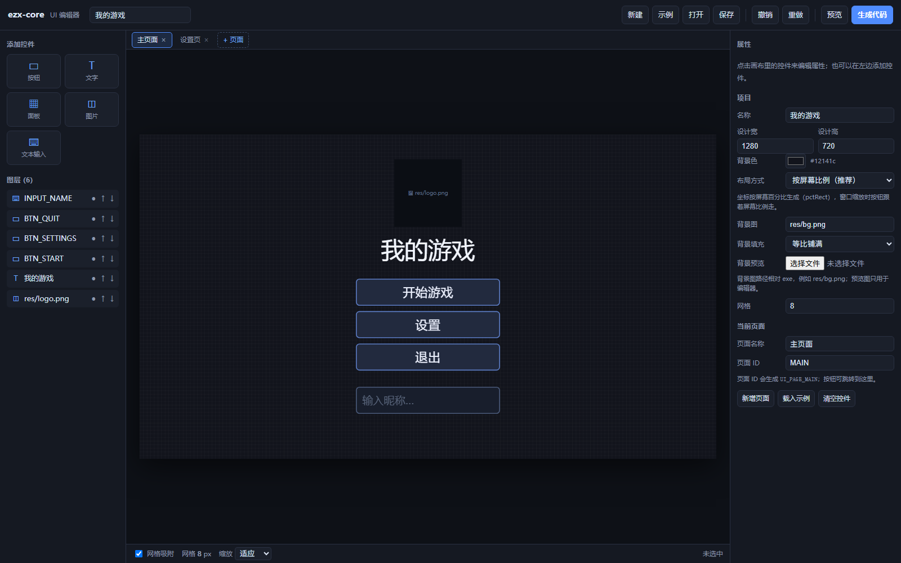
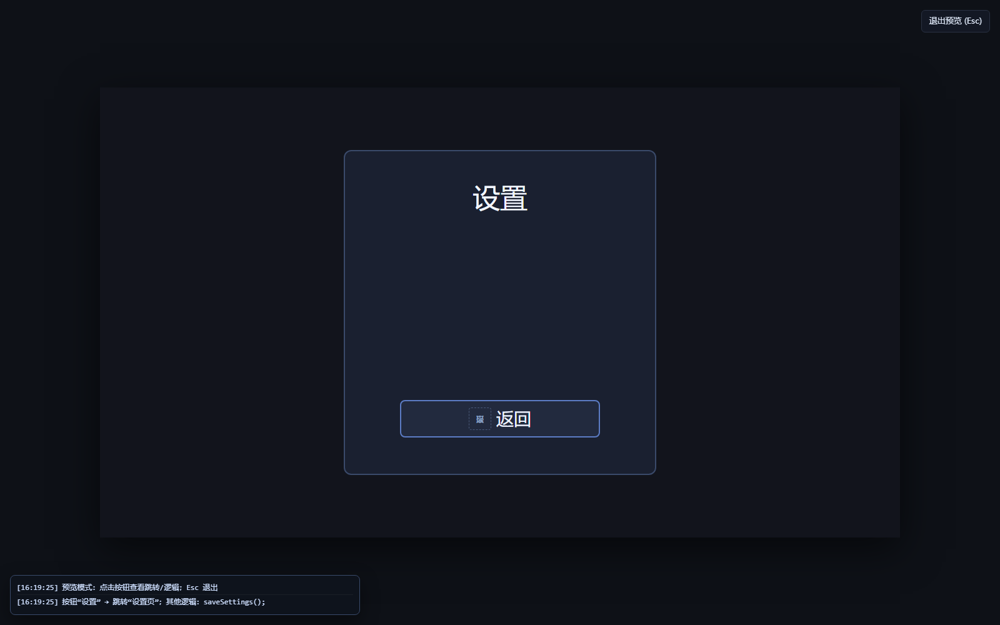
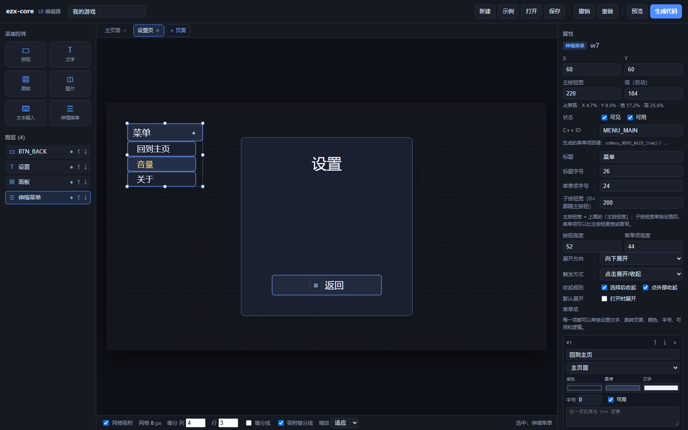
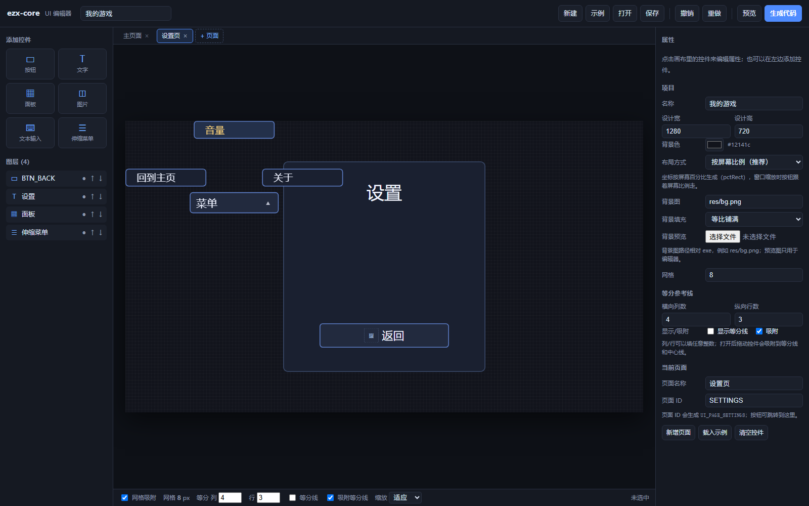
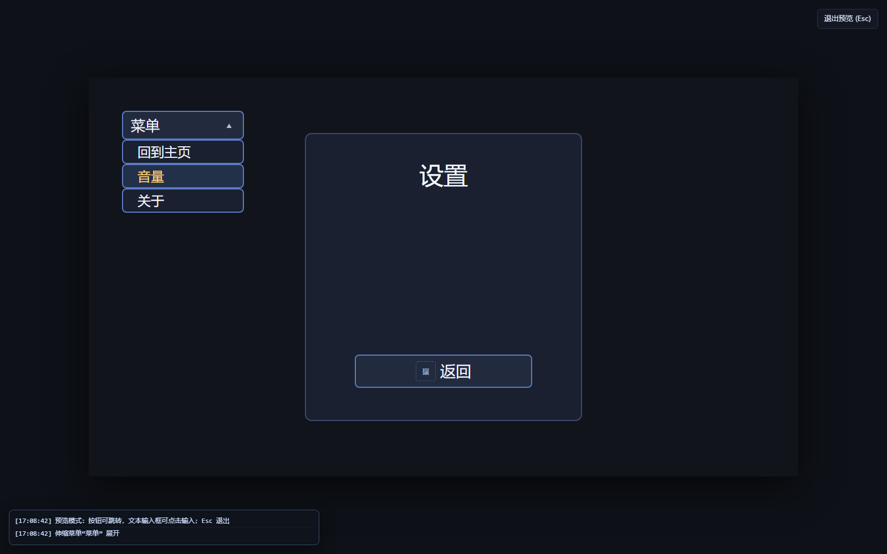
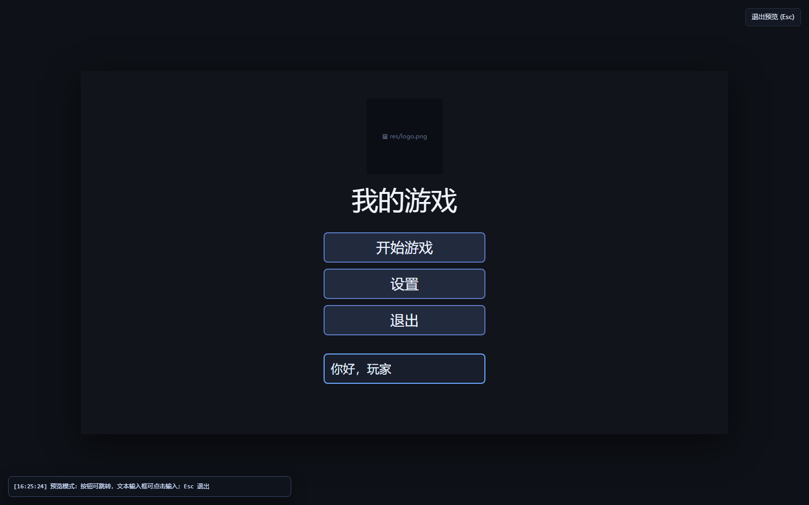

# ezx-core UI 编辑器

单文件、离线、零依赖的可视化编辑器：拖控件 → 调参数 → 生成 C++。



## 打开

双击 `editor/ui_editor.html`，用 Edge/Chrome 打开，不需要安装、不需要服务器。

## 界面

```
┌─────────────────────────────────────────────────────────────┐
│ 新建 / 示例 / 打开 / 保存 / 撤销 / 重做 / 预览 / 生成代码      │
├──────────┬──────────────────────────────────┬───────────────┤
│ 添加控件  │ 页面标签：主页面 / 设置页 / +页面 │ 属性面板       │
│ 图层      │        1280×720 画布            │ 位置/颜色/逻辑 │
│          │        （等分线、网格、吸附）      │ 跳转/菜单/背景 │
├──────────┴──────────────────────────────────┴───────────────┤
│ 图层列表 / 等分参考线 / 缩放                                 │
└─────────────────────────────────────────────────────────────┘
```

## 基本操作

| 操作 | 说明 |
|---|---|
| 添加 | 左侧：按钮 / 文字 / 面板 / 图片 / 文本输入 / 伸缩菜单 |
| 选中 | 点控件；点空白取消 |
| 移动 | 拖动控件，默认吸附 8px 网格 |
| 缩放 | 拖选中框的 8 个小白点 |
| 居中 | 属性面板：水平 / 垂直 / 页面居中 |
| 层级 | 图层 ↑↓，或属性面板上移/下移/置顶/置底 |
| 复制/删除 | 属性面板，或 `Ctrl+D` / `Delete` |
| 撤销/重做 | `Ctrl+Z` / `Ctrl+Y` |
| 保存/打开 | `Ctrl+S` 或「保存」/「打开」JSON |
| 预览 | 隐藏面板，看实际交互；`Esc` 退出 |

## 布局方式

不选中控件时，「项目」里可选：

- **按屏幕比例（默认）**：生成 `pctRect(vp, x%, y%, w%, h%)`，窗口缩放时跟着比例走；
- **固定设计坐标**：生成 `Rect{x,y,w,h}`，按 1280×720 固定。

比例布局使用 `vp.area()` 计算可见区域。要铺满窗口：

```cpp
vp.setScaleMode(ScaleMode::Cover);
```

要保留 16:9 黑边就用默认 `Contain`。

## 等分参考线

底部状态栏或「项目」面板：

- **列数 / 行数**：任意整数，画竖线/横线；
- **显示等分线**；
- **吸附等分线**：控件左/中/右边缘吸附到等分线和中心线。

等分线只用于排版，不写进生成代码。

## 页面

画布上方标签：

- **`+ 页面`**：新增；
- 点标签：切换；
- 双击：重命名；
- **×**：删除（至少保留一个）。

按钮属性「跳转页面」会让生成的回调里明确写 `goPage(...)`。生成代码包含：

```cpp
enum UiPage { UI_PAGE_MAIN = 0, UI_PAGE_SETTINGS = 1 };
void goPage(int page);
int currentPage();
```

`update()` / `draw()` 自动按当前页分发。

## 预览

- 按钮：真正执行页面跳转；
- 文本输入框：可点击、输入、密码/只数字/最大长度；
- 伸缩菜单：展开/收起、菜单项跳转；
- 左下角日志显示按钮/菜单项跳转和其他逻辑；
- 其他 C++ 逻辑不会在浏览器里执行，只提示；
- `Esc` 返回，并回到进入预览前的编辑页面。



## 控件

### 按钮

- C++ ID、文字、字号、颜色、边框、圆角、禁用样式；
- 图标：路径、大小、间距、左/右/上；
- 背景图：拉伸铺满按钮；
- 跳转页面；
- 按钮逻辑（写入生成的 `onButton_xxx()`）。

### 伸缩菜单



- **展开方向**：向下 / 向上 / 向左 / 向右 / 扇形；
- **触发方式**：点击 / 悬停；
- **收起规则**：选择后收起 / 点外部收起；
- **默认展开**；
- **主按钮宽**（通用「宽」）和 **子按钮宽** 分开设置（0 = 跟随主按钮）；
- 每个菜单项单独设置：
  - 文字、跳转页面；
  - 底色 / 悬停色 / 文字色；
  - 字号（0 = 继承）、可用/禁用；
  - 这一项的其他逻辑。

扇形参数：半径、起始角度、结束角度（0=右，90=下，180=左，270=上）。





### 文字 / 面板

- 文字：内容、字号、颜色、左/中/右对齐。
- 面板：填充色、边框、圆角、背景图。

### 图片

- 路径：`assetPath` 相对 exe，例如 `res/logo.png`；
- 缩放：等比放入 / 等比铺满 / 拉伸；
- 预览图只用于编辑器，不写进代码。

### 文本输入

- 占位文字、初始文字、字号、最大长度；
- 只数字、密码；
- 背景/边框/聚焦边框/文字颜色、圆角、背景图；
- 生成 `TextInput`，自动处理聚焦、光标、输入。



## 生成代码

点「生成代码」→ 复制或下载 `ui_generated.cpp`。

接口：

```cpp
namespace ui {
    void init();
    void update(const ezx::Input&, const ezx::Viewport&);
    void draw(const ezx::Viewport&, const ezx::Input&);
    void goPage(int page);

    // 每个按钮/菜单项一个回调
    // static void onButton_MAIN_BTN_START();
    // static void onMenu_SETTINGS_MENU_MAIN_Item1();
}
```

接入：

```cpp
#include "easyx_core.h"

namespace ui {
    void init();
    void update(const ezx::Input&, const ezx::Viewport&);
    void draw(const ezx::Viewport&, const ezx::Input&);
}

using namespace ezx;

int main()
{
    Window::enableDpiAwareness();
    Window win;
    Viewport vp;
    Input in;

    vp.setDesign(1280, 720);
    win.onResize([&](int w, int h) { vp.fit(w, h); });
    if (!win.open(1024, 640)) return 1;

    vp.fit(win.width(), win.height());
    ui::init();

    while (true)
    {
        win.poll();
        in.update();
        ui::update(in, vp);

        win.beginFrame(RGB(8, 8, 12));
        vp.paintLetterbox(RGB(8, 8, 12));
        ui::draw(vp, in);
        win.endFrame();
    }
}
```

### 按钮/菜单项逻辑写哪

```cpp
static void onButton_MAIN_BTN_START()
{
    startGame();
}

static void onMenu_SETTINGS_MENU_MAIN_Item1()
{
    // 页面跳转（编辑器里配置的）
    goPage(UI_PAGE_MAIN);

    // 其他逻辑
}
```

常见：

```cpp
PostQuitMessage(0);                 // 退出
goPage(UI_PAGE_SETTINGS);           // 跳页面
g_gameState = GameState::Playing;   // 改状态
playSound("res/click.wav");         // 音效
saveSettings();                     // 保存
MessageBoxA(GetHWnd(), "提示", "点击了", MB_OK);
```

## 限制

- 生成的是设计时坐标，不是运行时布局引擎；
- 文字单行，没有滚动列表/动画时间轴；
- 按钮图标只支持图片+文字，不支持九宫格；
- 输入框不支持选中文本/右键菜单；
- 图片/背景预览只在浏览器内存，刷新后需重选；
- 生成代码需要 C++17 + EasyX + ezx-core，`/MT`、`/utf-8`。

## 文件

```
editor/
├─ ui_editor.html        编辑器（双击打开）
├─ example-ui.json       示例工程
├─ example-generated.cpp 示例生成代码
└─ images/               截图
```
