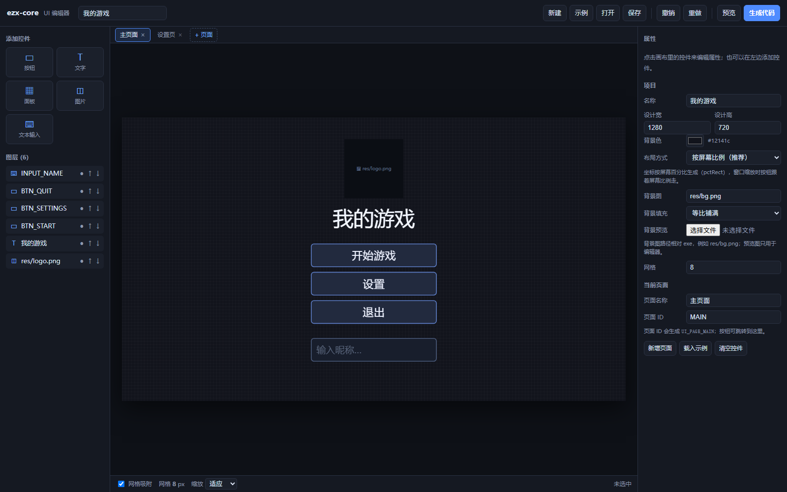
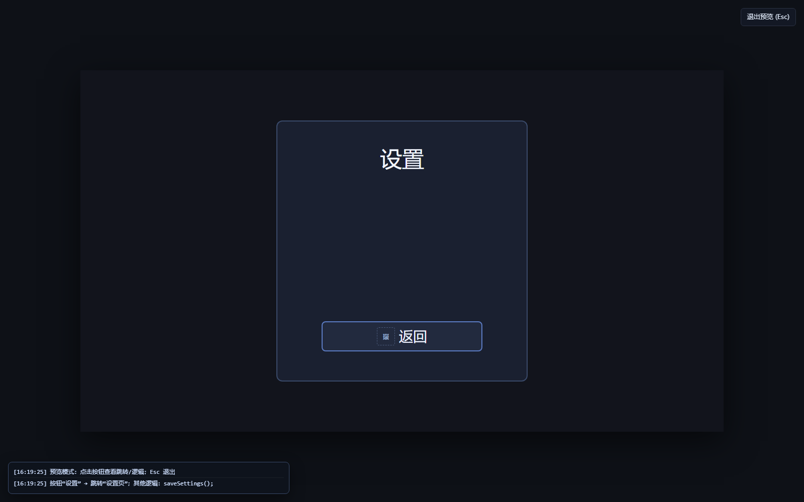
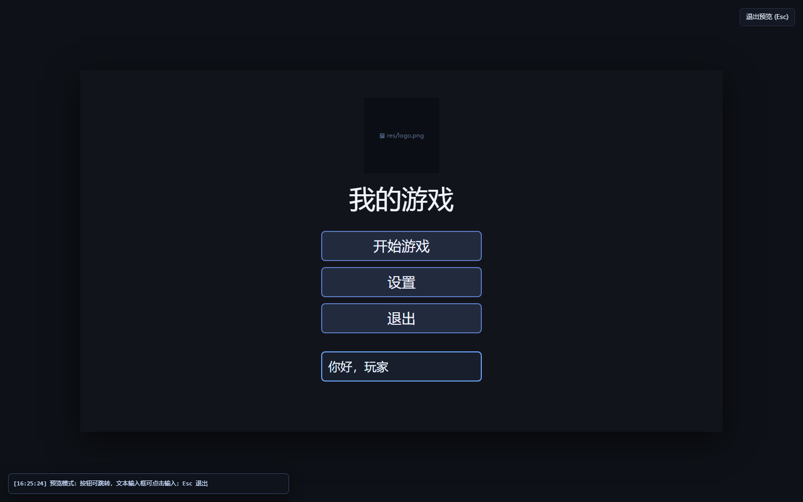
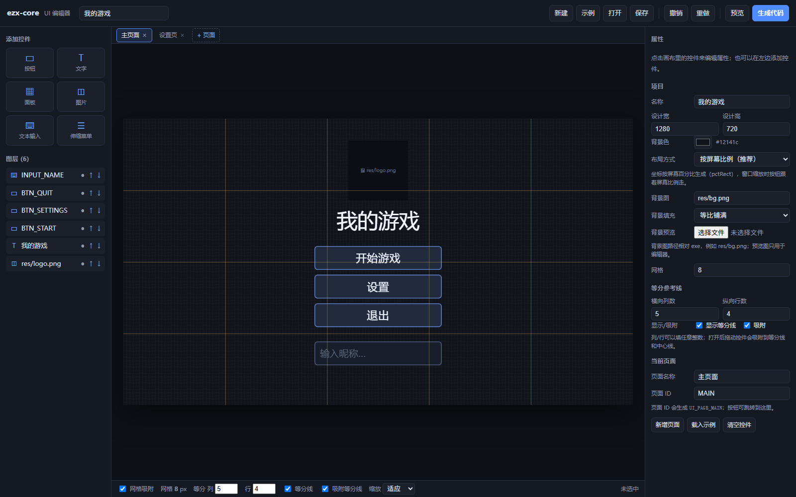
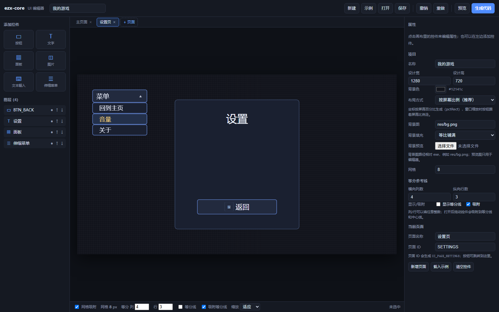
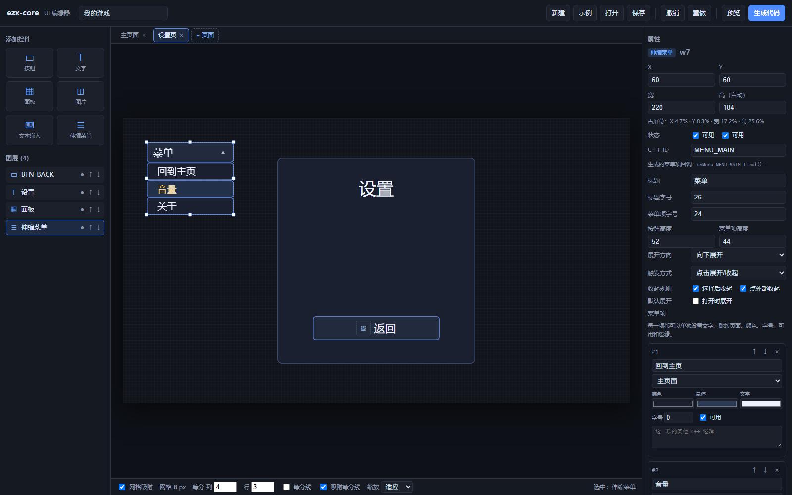
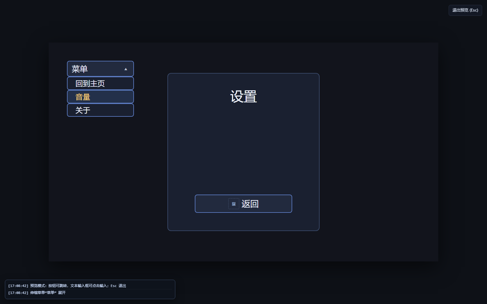

# ezx-core UI 编辑器

一个**单文件、离线、零依赖**的可视化界面编辑器：拖控件、调参数，然后直接生成能粘贴进 ezx-core 工程的 C++ 代码。点击按钮后的逻辑以 `case` 形式留好接口，你只需要往里面填代码。



## 打开

双击 `ui_editor.html`，用 Edge / Chrome 打开即可，**不需要装任何东西、不需要起服务器**。

推荐用 Edge/Chrome 打开；IE 不支持。

## 界面

```
┌─────────────────────────────────────────────────────────────┐
│ 新建 / 示例 / 打开 / 保存 / 撤销 / 重做 / 预览 / 生成代码      │
├──────────┬──────────────────────────────────┬───────────────┤
│ 添加控件  │ 页面标签：主页面 / 设置页 / +页面 │ 属性面板       │
│ 按钮      │                                  │ 位置/大小      │
│ 文字      │        1280 × 720 画布            │ 颜色/字号      │
│ 面板      │        （可缩放、网格吸附）        │ 按钮逻辑       │
│ 图片      │                                  │ 跳转页面       │
│ 文本输入  │                                  │ 图标/居中      │
├──────────┴──────────────────────────────────┴───────────────┤
│ 图层列表（点击选中，↑↓ 调层级，● 显示/隐藏）                  │
└─────────────────────────────────────────────────────────────┘
```

## 基本操作

| 操作 | 说明 |
|---|---|
| 添加 | 点左侧「按钮 / 文字 / 面板 / 图片 / 文本输入」 |
| 选中 | 点画布里的控件；点空白取消 |
| 移动 | 按住控件拖动，默认吸附 8px 网格 |
| 缩放 | 拖动选中框的 8 个小白点 |
| 调参 | 右侧属性面板；X/Y/宽/高/字号/颜色都能改 |
| 居中 | 属性面板「水平居中 / 垂直居中 / 页面居中」 |
| 层级 | 图层列表的 ↑↓，或属性面板「上移/下移/置顶/置底」 |
| 复制/删除 | 属性面板按钮；或 `Ctrl+D` / `Delete` |
| 撤销/重做 | `Ctrl+Z` / `Ctrl+Y` |
| 保存工程 | `Ctrl+S` 或「保存」→ 下载 `.json` |
| 打开工程 | 「打开」选择之前保存的 `.json` |
| 预览 | 「预览」隐藏编辑面板，只看界面；`Esc` 退出 |

画布默认 **1280×720**。底部可以切换 50%/75%/100%/125% 或「适应」。

## 布局方式：按屏幕比例（默认）

不选中控件时，右侧「项目」里可以选择：

- **按屏幕比例（推荐）**：生成 `pctRect(vp, x%, y%, w%, h%)`，按钮位置/大小跟着窗口比例走；
- **固定设计坐标**：生成 `Rect{ x, y, w, h }`，按 1280×720 设计像素固定。

比例布局生成的代码大致是：

```cpp
static Rect pctRect(const Viewport& vp, float x, float y, float w, float h)
{
    const Rect a = vp.area();
    const Point p0 = vp.toDesign(a.x + (int)(a.w * x), a.y + (int)(a.h * y));
    const Point p1 = vp.toDesign(a.x + (int)(a.w * (x + w)), a.y + (int)(a.h * (y + h)));
    return Rect{ p0.x, p0.y, p1.x - p0.x, p1.y - p0.y };
}
```

这样按钮在 50% 位置，窗口放大/缩小后仍保持在可见区域的 50%。

> 想要**铺满窗口**（而不是留黑边），在 `main` 里加：
> ```cpp
> vp.setScaleMode(ScaleMode::Cover);
> ```
> 想保留 16:9 黑边就用默认的 `Contain`；两种模式下比例布局都会正确换算。

## 预览

点右上角 **「预览」**：

- 隐藏编辑面板；
- **点击按钮会真正触发页面跳转**（按按钮「跳转页面」配置）；
- 左下角有**预览日志**：记录点击了哪个按钮、跳到哪个页面；
- 如果按钮的「按钮逻辑」里写了非注释代码，日志会提示“其他逻辑：`saveSettings();`”，提醒你这里还会执行别的东西；
- **文本输入框可以直接点击、输入**：支持光标、选中、密码、只数字、最大长度；预览值只是临时的，退出后不会改设计；
- `Esc` 或右上角「退出预览」返回；返回后会回到进入预览前的编辑页面。





## 等分参考线（横/竖任意数值）

底部状态栏和「项目」面板都有：

- **列数**：任意整数，画竖线；
- **行数**：任意整数，画横线；
- **显示等分线**：打开/关闭；
- **吸附等分线**：拖动控件时，控件左/中/右边缘会吸附到等分线和画面中心线。

例如 5 列 4 行：



等分线只用于编辑器排版，不会出现在生成代码里。

## 页面（跳转）

画布上方的标签就是页面：

- **`+ 页面`**：新增页面；
- 点标签：切换页面；
- **双击标签**：重命名；
- 标签上的 **×**：删除页面（至少保留一个）。

每个页面有自己的控件、图层和按钮。按钮属性里有 **「跳转页面」**：

- 选一个目标页面后，生成的回调里会**明确写一行** `goPage(...)`，不是藏在引擎里的“魔法”；
- 跳转和别的逻辑都在同一个函数里，顺序看得见：

```cpp
static void onButton_MAIN_BTN_SETTINGS()
{
    // 页面跳转（编辑器里配置的）
    goPage(UI_PAGE_SETTINGS);

    // 其他逻辑写在这里：
    // saveSettings();   // 跳转前后都可以加
}
```

- 也可以手写 `ui::goPage(UI_PAGE_SETTINGS);`。

生成代码会包含：

```cpp
enum UiPage
{
    UI_PAGE_MAIN = 0,
    UI_PAGE_SETTINGS = 1
};

void goPage(int page);
int currentPage();
```

`update()` / `draw()` 会按当前页面自动分发，不需要你写 `switch`。



## 背景图

在**不选中任何控件**时，右侧「项目」里有：

- **背景图**：相对 exe 的路径，例如 `res/bg.png`；
- **背景填充**：等比铺满 / 等比完整 / 拉伸；
- **背景预览**：只用于编辑器显示，不写进代码。

生成代码会在 `draw()` 最前面先填背景色，再画背景图：

```cpp
// 比例布局（默认）
vp.fill(pctRect(vp, 0, 0, 1, 1), RGB(18, 20, 28));
vp.imageCover(g_bg, pctRect(vp, 0, 0, 1, 1));

// 固定设计坐标
// vp.fill(Rect{ 0, 0, 1280, 720 }, RGB(18, 20, 28));
// vp.imageCover(g_bg, Rect{ 0, 0, 1280, 720 });
```

`init()` 里会自动 `g_bg.load(assetPath("res/bg.png"));`。

> 编辑器里如果没选「背景预览」，画布只显示背景色；生成代码仍然会用路径加载真实图片。

## 伸缩菜单

左侧「伸缩菜单」添加一个可展开/收起的菜单：

- 「标题」：菜单按钮上显示的文字；
- 「按钮高度」「菜单项高度」；
- **展开方向**：向下展开 / 向上展开；
- **触发方式**：点击展开收起 / 鼠标悬停展开；
- **收起规则**：选择菜单项后收起、点外部收起；
- **默认展开**：生成代码初始是展开还是收起；
- 菜单高度自动计算，只调宽度；
- **每个菜单项单独编辑**：
  - 文字；
  - 跳转页面（可单独选每个项跳到哪一页）；
  - 底色 / 悬停色 / 文字色；
  - 字号（0 = 继承菜单默认字号）；
  - 可用/禁用；
  - 「这一项的其他 C++ 逻辑」。

菜单项编辑器长这样：



预览里：

- 按「触发方式」展开/收起菜单；
- 菜单项单独跳转页面；
- 点菜单项 → 左下角日志显示跳转/其他逻辑；
- `默认展开` 控制进入预览时的状态。

生成代码：

```cpp
static bool g_p1_menu_1_open = false;

static void onMenu_SETTINGS_MENU_MAIN_Toggle()
{
    // 菜单已经自动展开/收起；这里写额外逻辑（可留空）
}

static void onMenu_SETTINGS_MENU_MAIN_Item1()
{
    // 页面跳转（编辑器里配置的）
    goPage(UI_PAGE_MAIN);

    // 其他逻辑写在这里：
    // TODO: 菜单项“回到主页”的逻辑
}

static void onMenu_SETTINGS_MENU_MAIN_Item2()
{
    // TODO: 菜单项“音量”的逻辑
}
```

每个菜单项的底色、悬停色、文字色、字号都会按编辑器里单独生成的 `fillRound` / `textIn` 参数输出。

菜单项要跳页面，就在对应函数里写：

```cpp
goPage(UI_PAGE_MAIN);
```



## 控件背景图（按钮 / 面板 / 文本输入）

按钮、面板、文本输入的属性里都有 **「背景图」**：

- 路径例如 `res/button_bg.png`；
- 生成代码会**拉伸铺满控件**：

```cpp
vp.image(g_p0_bg_1, r);
```

- 「背景预览」只用于编辑器显示；
- 和按钮的「图标」是两回事：
  - 背景图：铺在按钮/面板/输入框底下；
  - 图标：显示在按钮文字旁边/上方。
- 注意：生成代码里背景图是矩形拉伸，不会按圆角裁切；需要圆角裁切要自己加裁剪。

## 控件与生成代码

### 按钮

- `C++ ID`：例如 `BTN_START`。单页面生成 `UI_BTN_START`；多页面生成 `UI_MAIN_BTN_START`（页面 ID 做前缀，避免重名）。
- **每个按钮生成一个独立函数**，函数名就是 `onButton_<按钮ID>`，所有逻辑都写在这里：

```cpp
static void onButton_MAIN_BTN_START()
{
    // 这个按钮没有配置页面跳转，逻辑写在这里：
    // TODO: 开始游戏
    // startGame();
}
```

设置「跳转页面」后，同一函数里会多一行明确的 `goPage(...)`：

```cpp
static void onButton_MAIN_BTN_SETTINGS()
{
    // 页面跳转（编辑器里配置的）
    goPage(UI_PAGE_SETTINGS);

    // 其他逻辑写在这里：
    // saveSettings();
}
```

- 「按钮逻辑」里写 C++ 代码，会原样放进这个回调；页面跳转也在这里，不需要在别处找。
- **按钮图标**：
  - 「图标路径」：例如 `res/start.png`；
  - 「图标大小」「图标间距」「图标位置（左/右/上）」；
  - 「图标预览」只用于编辑器。
- 生成代码会自动 `load` 图标，并按左/右/上排版图标和文字。
- 悬停色、普通底色、边框、圆角、字号都会生成。
- 「可用」取消勾选 → 生成禁用样式，并且不响应点击。

### 文字 / 面板

- 文字：内容、字号、颜色、左/中/右对齐。
- 面板：填充色、边框色、边框粗细、圆角。

### 图片

- 「图片路径」写相对 exe 的路径，例如 `res/logo.png`。
- 缩放方式：
  - 等比完整 → `vp.imageFit`
  - 等比铺满 → `vp.imageCover`
  - 拉伸 → `vp.image`
- 「预览图」只用于编辑器显示，不会写进代码。

### 文本输入

- 左侧「文本输入」添加一个 `TextInput`。
- 可调：占位文字、初始文字、字号、最大长度、只数字、密码、背景/边框/聚焦边框/文字颜色、圆角。
- 生成代码自动处理：
  - 点击输入框聚焦；
  - `placeCursor` 把光标放到点击位置；
  - 光标闪烁；
  - 多个输入框时，点哪个哪个获得焦点。

## 自动居中

选中控件后，属性面板底部有：

- **水平居中**：`x = (设计宽 - 控件宽) / 2`；
- **垂直居中**：`y = (设计高 - 控件高) / 2`；
- **页面居中**：两者同时。

设置后，改设计分辨率或改控件宽高时会**自动重新居中**；手动拖动控件会取消居中标记（因为你要自己摆位置）。

生成代码里是当前计算出的固定坐标；运行时窗口缩放由 `Viewport` 统一缩放。

## 生成代码

点右上角「生成代码」：

- 代码显示在弹窗里，可以「复制」或「下载 .cpp」；
- 文件建议命名 `ui_generated.cpp`；
- 多页面会生成：

```cpp
namespace ui {
    void init();
    void update(const ezx::Input& in, const ezx::Viewport& vp);
    void draw(const ezx::Viewport& vp, const ezx::Input& in);
    void goPage(int page);
    int  currentPage();

    // 每个按钮一个回调（函数名随按钮 ID 变化）
    // static void onButton_MAIN_BTN_START();
    // static void onButton_MAIN_BTN_SETTINGS();
}
```

### 接入工程

1. 把 `ui_generated.cpp`、`easyx_core.h`、`easyx_core.cpp` 放进项目（根目录或 `src\` 都行）。
2. 在 VS 里「添加 → 现有项」把两个 `.cpp` 加进去。
3. 在 `main.cpp` 里声明并调用：

```cpp
#include "easyx_core.h"

namespace ui {
    void init();
    void update(const ezx::Input& in, const ezx::Viewport& vp);
    void draw(const ezx::Viewport& vp, const ezx::Input& in);
    void goPage(int page);
}

using namespace ezx;

int main()
{
    Window::enableDpiAwareness();
    Window win;
    Viewport vp;
    Input in;

    vp.setDesign(1280, 720);                 // 和编辑器里的设计分辨率一致
    vp.setScaleMode(ScaleMode::Cover);       // 比例布局铺满窗口；想留黑边用 Contain
    win.onResize([&](int w, int h) { vp.fit(w, h); });
    if (!win.open(1024, 640)) return 1;

    vp.fit(win.width(), win.height());
    ui::init();                              // 图片、输入框初始化

    while (true)
    {
        win.poll();
        in.update();
        if (in.keyDown(VK_ESCAPE)) break;

        ui::update(in, vp);                  // 先更新交互
        win.beginFrame(RGB(8, 8, 12));
        vp.paintLetterbox(RGB(8, 8, 12));
        ui::draw(vp, in);                    // 再画
        win.endFrame();
    }
    return 0;
}
```

> `ui::init()` 必须在窗口创建之后调用；图片用 `assetPath("res/...")` 加载，所以 `res` 要跟 exe 放一起。

### 按钮逻辑写在哪

**每个按钮一个函数**，函数名就是按钮 ID：

```cpp
// 按钮：开始游戏
static void onButton_MAIN_BTN_START()
{
    // 这个按钮没有配置页面跳转，逻辑写在这里：
    // TODO: 开始游戏
    // startGame();
}

// 按钮：设置（跳转到“设置页”）
static void onButton_MAIN_BTN_SETTINGS()
{
    // 页面跳转（编辑器里配置的）
    goPage(UI_PAGE_SETTINGS);

    // 其他逻辑写在这里：
    // saveSettings();
}
```

分发函数是生成的，一般不用改：

```cpp
static void onButtonClick(UiId id)
{
    switch (id)
    {
    case UI_MAIN_BTN_START:    onButton_MAIN_BTN_START(); break;
    case UI_MAIN_BTN_SETTINGS: onButton_MAIN_BTN_SETTINGS(); break;
    default: break;
    }
}
```

这样一眼能看出：

- 哪个按钮对应哪个函数；
- 页面跳转发生在哪一行；
- 跳转之外的其他逻辑写在哪。

页面切换也可以手写：

```cpp
ui::goPage(UI_PAGE_SETTINGS);
```

#### 其他常见逻辑示例

```cpp
// 退出游戏（EasyX 窗口程序）
PostQuitMessage(0);

// 改游戏状态（自己定义的全局/成员变量）
g_gameState = GameState::Playing;

// 播放音效（自己封装的函数）
playSound("res/click.wav");

// 保存设置
saveSettings();

// 打开一个 MessageBox
MessageBoxA(GetHWnd(), "提示", "按钮被点击了", MB_OK);

// 菜单项里跳页面
goPage(UI_PAGE_MAIN);
```

这些代码可以直接写在：

1. 编辑器的「按钮逻辑」输入框里（会生成到对应回调）；或
2. 生成后的 `ui_generated.cpp` 里对应 `onButton_xxx()` / `onMenu_xxx_ItemN()` 函数。

> 回调函数是 `static` 的，调用项目里的其他函数时，确保它们已经在上面声明/定义，或者自己加前置声明。

## 保存格式

保存的 `.json` 包含所有页面；可以提交到 git、发给别人；编辑器启动时会自动从浏览器 `localStorage` 恢复上次编辑。

「新建」清空当前界面；「示例」载入内置的双页面示例（见 `example-ui.json`）。

## 限制（当前版本）

- 生成的是**设计时算好的坐标**（比例或固定），不是运行时 flex 布局；比例布局依赖 `Viewport::area()` 换算。
- 文字是单行；没有换行排版、滚动列表、动画时间轴。
- 按钮图标是图片 + 文字，不支持九宫格/圆角裁切。
- 输入框只支持单击聚焦、键盘输入；没有选中文本、右键菜单。
- 图片/背景预览只存在浏览器内存里，刷新后需要重新选预览图（代码只使用路径）。
- 生成代码是 C++17 + EasyX + ezx-core，Windows/MSVC；需要 `/MT`、`/utf-8`（`Directory.Build.targets` 会自动加）。

## 文件

```
editor/
├─ ui_editor.html        编辑器（单文件，直接双击）
├─ README.md             本文件
├─ example-ui.json       双页面示例工程（可在编辑器里打开）
├─ example-generated.cpp 示例工程生成的 C++ 代码（可直接编译）
├─ editor_preview.png      界面截图
├─ editor_selected.png     选中按钮时的属性面板截图
├─ editor_page2.png        第二页（页面跳转）截图
├─ editor_preview_mode.png 预览模式（按钮跳转 + 日志）截图
├─ editor_preview_input.png 预览模式（文本输入框）截图
├─ editor_guides.png       等分参考线截图
├─ editor_preview_menu.png 预览模式（伸缩菜单）截图
└─ editor_menu_props.png   菜单项单独编辑截图
```
